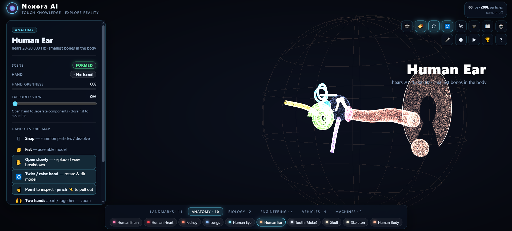
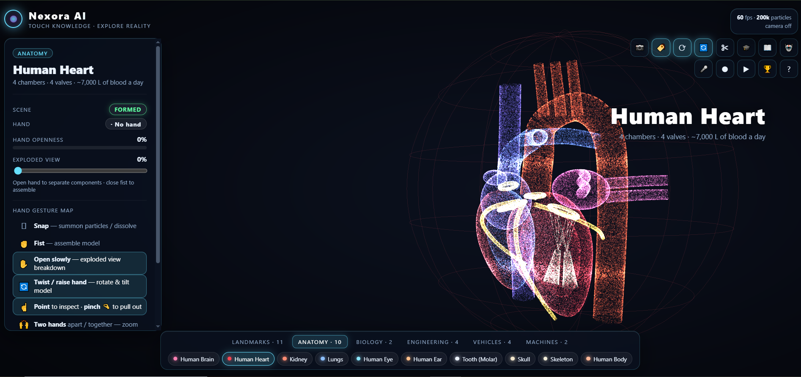
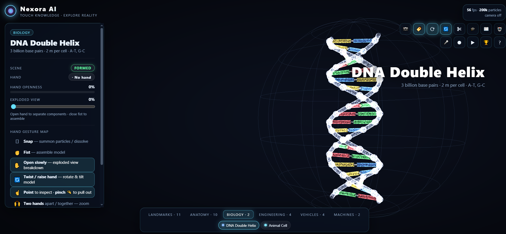
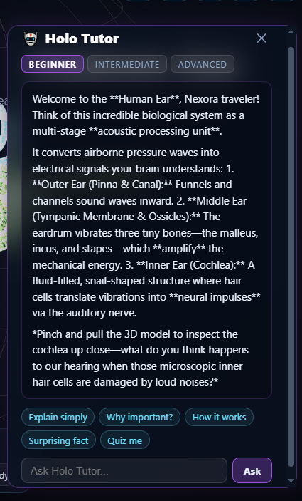
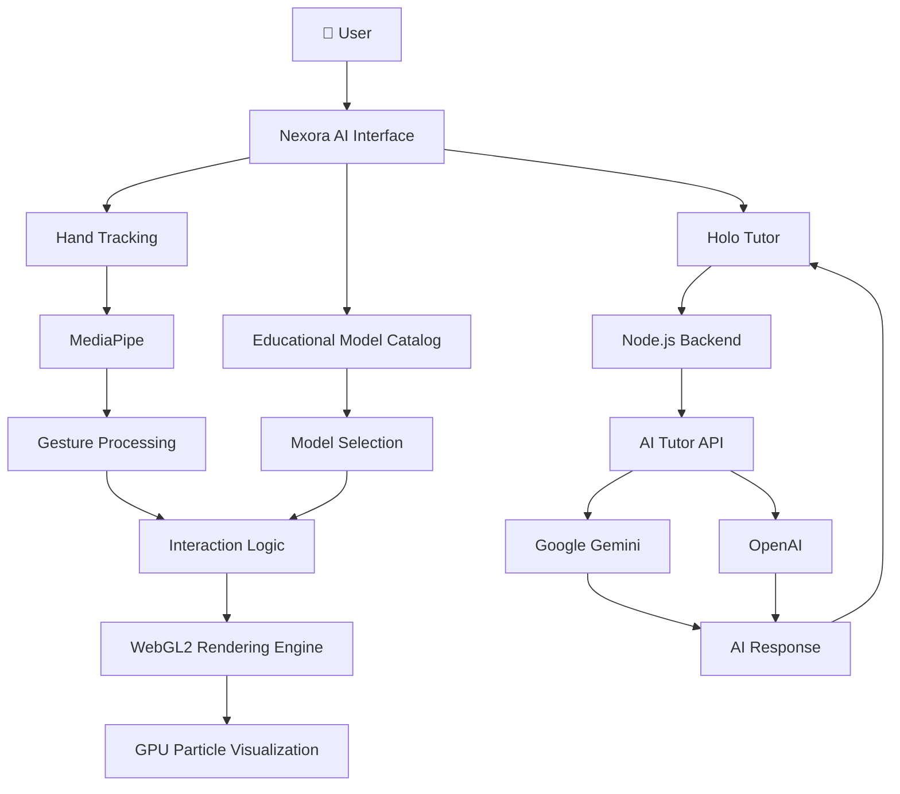

# 🌌 Nexora AI
### Touch Knowledge. Explore Reality.

<p align="center">
  
</p>

<p align="center">
  <b>Explore. Interact. Discover.</b><br/>
  An AI-powered, gesture-controlled 3D interactive learning laboratory.
</p>

<p align="center">
  <a href="https://github.com/piyushhjha/Nexora">
    
  </a>
  
  
  
  
  
</p>

<p align="center">
  <a href="#-overview">Overview</a> •
  <a href="#-screenshots">Screenshots</a> •
  <a href="#-getting-started">Installation</a> •
  <a href="#-architecture">Architecture</a> •
  <a href="#-technology-stack">Tech Stack</a>
</p>

---

## ✨ What is Nexora AI?

**What if you could learn about the human heart by interacting with it in 3D, explore DNA through particle visualizations, and control everything using your hands?**

That's the idea behind **Nexora AI**.

Nexora is an interactive educational platform that combines:

- 🧠 AI-powered educational assistance
- 🖐️ Real-time hand gesture recognition
- 🌌 GPU-accelerated particle visualization
- 🧬 Interactive 3D educational models
- 🎓 Personalized explanations at different learning levels

Instead of simply reading about complex concepts, users can explore their structures, manipulate visualizations, inspect components, and ask questions through an integrated AI Tutor.

<p align="center">
  <b>Don't just learn how things work. Interact with them.</b>
</p>

---

## 🎬 Explore Nexora

### Application Preview

<p align="center">
  
  
  
</p>

<p align="center">
  
</p>

---

## 🚀 Features

<table>
<tr>
<td width="50%" valign="top">

### 🌌 Interactive 3D Visualization

- GPU-based particle rendering.
- Dynamic particle formation and dissolution.
- Model rotation and exploration.
- Exploded-view visualization.
- Interactive component inspection.

</td>
<td width="50%" valign="top">

### 🖐️ Hand Gesture Control

- Real-time hand landmark detection.
- Gesture-based model manipulation.
- Camera-based interaction.
- Natural touch-free navigation.
- Two-hand interaction support.

</td>
</tr>
<tr>
<td width="50%" valign="top">

### 🤖 Holo Tutor

- Gemini AI integration.
- OpenAI alternative.
- Context-aware explanations.
- Beginner, Intermediate and Advanced levels.
- Interactive learning prompts and quizzes.

</td>
<td width="50%" valign="top">

### 🎓 Educational Model Catalog

- 33 interactive learning models.
- Six educational categories.
- Anatomy and biology exploration.
- Engineering and mechanical concepts.
- Historical landmarks and vehicles.

</td>
</tr>
</table>

---

## 🧭 Explore the Learning Catalog

Nexora currently includes **33 educational models across 6 categories**.

| Category | Models | Examples |
|---|---:|---|
| 🏛️ Landmarks | 11 | Great Pyramid, Eiffel Tower, Taj Mahal, Burj Khalifa |
| 🫀 Anatomy | 10 | Human Heart, Brain, Kidney, Lungs, Skeleton |
| 🧬 Biology | 2 | DNA Double Helix, Animal Cell |
| ⚙️ Engineering | 4 | Interactive engineering models |
| 🚗 Vehicles | 4 | Vehicle models |
| 🏭 Machines | 2 | Mechanical models |
| **Total** | **33** | **6 Categories** |

<details>
<summary><b>🫀 Explore Anatomy models</b></summary>

- Human Brain
- Human Heart
- Kidney
- Lungs
- Human Eye
- Human Ear
- Tooth (Molar)
- Skull
- Skeleton
- Human Body

</details>

<details>
<summary><b>🧬 Explore Biology models</b></summary>

- DNA Double Helix
- Animal Cell

</details>

<details>
<summary><b>🏛️ Explore Landmark models</b></summary>

- Turtle Tower
- Eiffel Tower
- Statue of Liberty
- Burj Khalifa
- Great Pyramid
- Colosseum
- Leaning Tower of Pisa
- Taj Mahal
- Big Ben
- Christ the Redeemer
- Sydney Opera House

</details>

<details>
<summary><b>⚙️ Explore Engineering, Vehicles and Machines</b></summary>

- Engineering: 4 models
- Vehicles: 4 models
- Machines: 2 models

</details>

---

## 🖐️ Gesture Interaction System

Nexora uses **MediaPipe Hand Landmarker** to detect hand landmarks and interpret gestures.

Users can interact with the models without relying entirely on traditional mouse and keyboard controls.

| Gesture | Interaction |
|---|---|
| 🤏 Snap | Summon particles / dissolve |
| ✊ Fist | Assemble the model |
| 🖐️ Open hand | Explore the next model |
| 🖐️ Slowly open hand | Trigger exploded view |
| 🔄 Twist / Raise hand | Rotate and tilt |
| ☝️ Point | Inspect a component |
| 🤏 Pinch | Pull out a component |
| 🙌 Two hands apart | Zoom in |
| 🤲 Two hands together | Zoom out |
| ✌️ Peace | Jump to the next learning model |

*Gesture recognition depends on camera visibility, hand position, and the interaction logic implemented for the selected model.*

---

## 🤖 Meet Holo Tutor

**Your AI-powered learning companion.**

Holo Tutor provides explanations based on the currently selected educational model and the user's question.

### Learning Modes

<table>
<tr>
<td align="center" width="33%">
<h3>🟢 Beginner</h3>
Simple explanations, intuitive analogies and basic concepts.
</td>
<td align="center" width="33%">
<h3>🟣 Intermediate</h3>
Scientific terminology, mechanisms and cause-and-effect relationships.
</td>
<td align="center" width="33%">
<h3>🔵 Advanced</h3>
Detailed technical explanations and deeper scientific concepts.
</td>
</tr>
</table>

### What can you ask?

- Explain simply.
- Why is this important?
- How does it work?
- Tell me a surprising fact.
- Quiz me.

**AI Providers:**
- Google Gemini API
- OpenAI API

The backend handles AI requests and keeps provider API keys away from frontend code.

---

## ⚙️ Technology Stack

<p align="center">
  
</p>

| Technology | How Nexora Uses It |
|---|---|
| HTML5 | Application structure |
| CSS3 | Interface design and styling |
| JavaScript ES Modules | Application logic and modular architecture |
| WebGL2 | GPU-accelerated particle rendering |
| MediaPipe Tasks Vision | Hand landmark detection |
| Node.js | Backend runtime |
| Node.js HTTP Module | Static hosting and API endpoints |
| Google Gemini API | AI educational assistant |
| OpenAI API | Alternative AI provider |
| Playwright | Browser automation and testing |

---

## 🏗️ Architecture

Nexora connects computer vision, interaction logic, GPU rendering, and AI services into one learning environment.



### How it works

1. The user selects an educational model.
2. The model is loaded into the interactive visualization environment.
3. MediaPipe detects hand landmarks through the camera.
4. Gesture logic interprets the user's movements.
5. WebGL2 renders the corresponding visual changes.
6. Holo Tutor receives questions and model context.
7. The backend communicates with the configured AI provider.
8. The AI-generated explanation appears in the learning interface.

---

## 💻 Getting Started

Want to run Nexora on your own computer? Follow these steps.

### Prerequisites

| Requirement | Recommended |
|---|---|
| Node.js | Version 20 or later |
| npm | Comes with Node.js |
| Browser | Chrome / Edge |
| Webcam | Required for hand tracking |
| GPU | WebGL2-compatible graphics hardware |
| Internet | Required for AI Tutor |

### 1. Clone the repository

```bash
git clone https://github.com/piyushhjha/Nexora.git
```

### 2. Navigate to the project

```bash
cd Nexora
```

### 3. Install dependencies

```bash
npm install
```

### 4. Configure environment variables

Create a `.env` file in the root directory.

For Google Gemini:

```env
GEMINI_API_KEY=your_gemini_api_key
```

Or for OpenAI:

```env
OPENAI_API_KEY=your_openai_api_key
```

Get your API key:

- [Google AI Studio](https://aistudio.google.com/)
- [OpenAI API Platform](https://platform.openai.com/api-keys)

<details>
<summary><b>🔐 Important API key security information</b></summary>

- Never commit your `.env` file to GitHub.
- Keep API credentials on the backend.
- The current backend prioritizes Gemini when both keys are configured.
- An API key is required for AI Tutor functionality, but the interactive visualization features can be explored independently.

</details>

### 5. Start Nexora

```bash
npm start
```

### 6. Open in your browser

<p align="center">
  <a href="http://localhost:5173/">
    
  </a>
</p>

```text
http://localhost:5173/
```

**That's it!** Nexora is now running locally.

> **Note:** Nexora uses its own Node.js server through `server.mjs`. Run `npm start`; the project does not require a separate Vite development server.

---

## 🔌 Backend API

Nexora uses a lightweight Node.js HTTP server.

| Method | Endpoint | Description |
|---|---|---|
| GET | `/api/status` | Application and AI configuration status |
| POST | `/api/tutor` | Sends questions to the AI Tutor |

### Check application status

```http
GET http://localhost:5173/api/status
```

Example response:

```json
{
  "ok": true,
  "app": "Nexora AI",
  "status": "online",
  "version": "2.0.0",
  "catalogSize": 33,
  "aiConfigured": true
}
```

### Send an AI Tutor request

```http
POST http://localhost:5173/api/tutor
Content-Type: application/json
```

Example request:

```json
{
  "model": "Human Heart",
  "component": "Left Ventricle",
  "question": "What is the function of the left ventricle?",
  "level": "intermediate",
  "metadata": {
    "info": "A chamber responsible for pumping oxygenated blood."
  }
}
```

The backend uses the selected model, component, educational level, and question to generate a contextual response.

---

## 📁 Project Structure

<details>
<summary><b>📂 View the project directory structure</b></summary>

```text
Nexora/
│
├── docs/
│   └── screenshots/
│
├── models/
│   └── hand_landmarker.task
│
├── src/
│   ├── app.js
│   ├── hands.js
│   ├── features.js
│   ├── education.js
│   ├── worker.js
│   │
│   ├── gl/
│   │   └── WebGL2 rendering modules
│   │
│   ├── logic/
│   │   └── Interaction and application logic
│   │
│   ├── lib/
│   │   └── Utility modules
│   │
│   └── models/
│       └── Educational model definitions
│
├── tests/
│
├── .env.example
├── .gitignore
├── index.html
├── package.json
├── package-lock.json
├── playwright.config.js
├── server.mjs
└── styles.css
```

</details>

### Main Components

| File | Responsibility |
|---|---|
| `index.html` | Main application entry |
| `styles.css` | UI and styling |
| `server.mjs` | HTTP server and AI API |
| `src/app.js` | Application initialization |
| `src/hands.js` | Hand tracking |
| `src/features.js` | Interactive features |
| `src/education.js` | Educational functionality |
| `src/gl/` | GPU and WebGL2 rendering |
| `src/logic/` | Interaction logic |
| `src/lib/` | Shared utilities |
| `src/models/` | Educational models |
| `models/` | MediaPipe model asset |
| `tests/` | Automated tests |

---

## 🧪 Testing

Nexora includes Playwright for browser-based testing.

Run the test suite:

```bash
npm test
```

View the test report:

```bash
npm run test:report
```

If browser binaries are not installed, run:

```bash
npx playwright install
```

---

## 🌍 Real-World Applications

| Domain | Potential Application |
|---|---|
| 🏥 Medical Education | Interactive anatomy and organ exploration |
| 🧬 Biology | DNA, cell structures and biological concepts |
| 🏫 Schools & Colleges | Interactive classroom demonstrations |
| ⚙️ Engineering | Exploring structures and mechanical components |
| 🏛️ History & Geography | Visual exploration of landmarks |
| 🎓 Digital Learning | AI-assisted personalized explanations |

Nexora is designed as an educational exploration platform. Its visualizations are learning aids, not substitutes for professional medical or engineering tools.

---

## 🔮 What's Next?

Potential enhancements for future versions:

- [ ] More educational 3D models.
- [ ] Improved hand gesture recognition.
- [ ] More detailed component-level interactions.
- [ ] Interactive quizzes and assessments.
- [ ] User accounts and personalized learning progress.
- [ ] Learning history and saved sessions.
- [ ] Multilingual AI Tutor.
- [ ] Improved mobile and tablet support.
- [ ] Collaborative learning experiences.
- [ ] Additional AI provider integrations.

---

## 👨‍💻 About the Developer

<p align="center">
  <b>Piyush Ranjan Jha</b><br/>
  Computer Science and Engineering
</p>

<p align="center">
  <a href="https://github.com/piyushhjha">
    
  </a>
  <a href="https://github.com/piyushhjha/Nexora">
    
  </a>
</p>

---

## ⭐ Support the Project

If you find Nexora AI interesting:

- ⭐ Star this repository.
- 🍴 Fork the project.
- 🧪 Explore the application.
- 💡 Suggest new features.
- 🤝 Contribute improvements.

<p align="center">
  <b>Made to make learning more interactive.</b>
  <br/><br/>
  🌌 <b>NEXORA AI</b>
  <br/>
  <i>Touch Knowledge. Explore Reality.</i>
</p>
